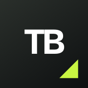
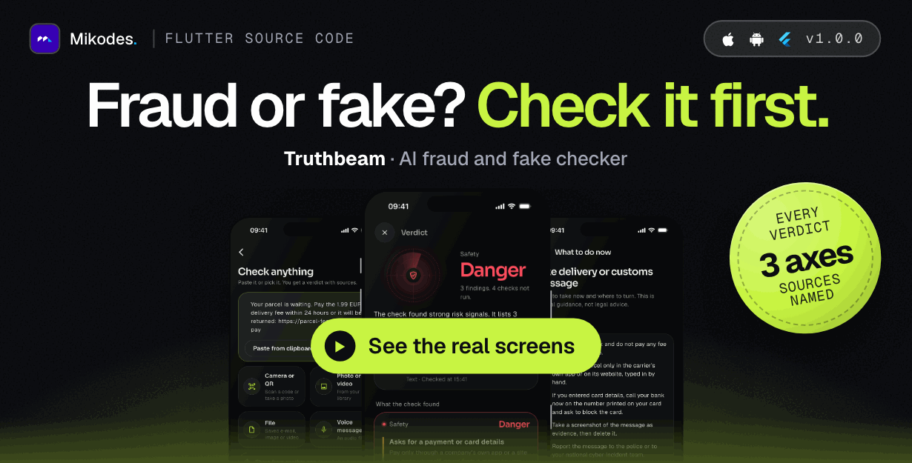
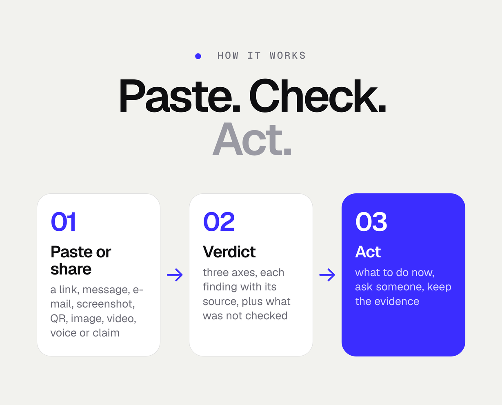
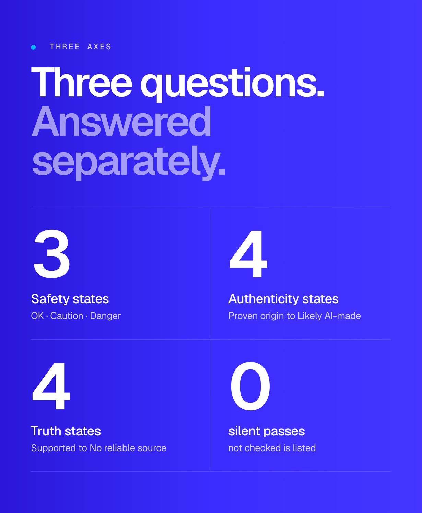
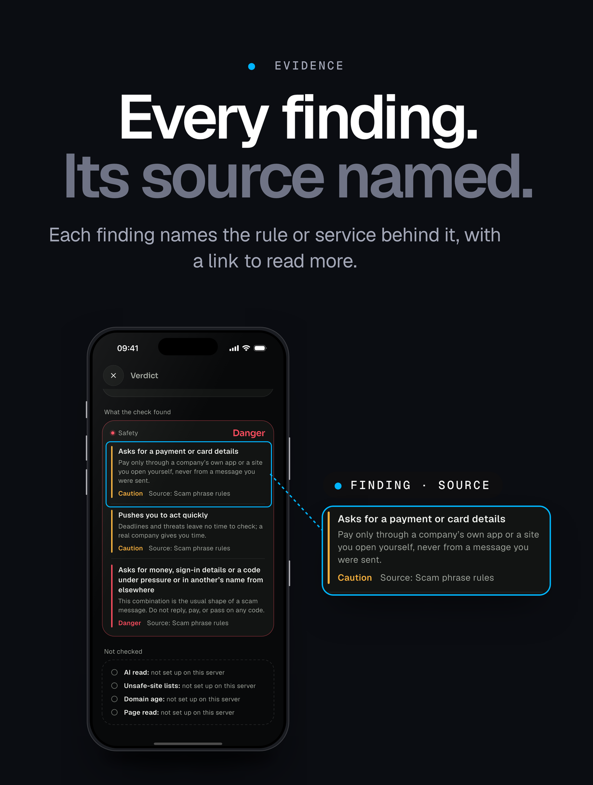
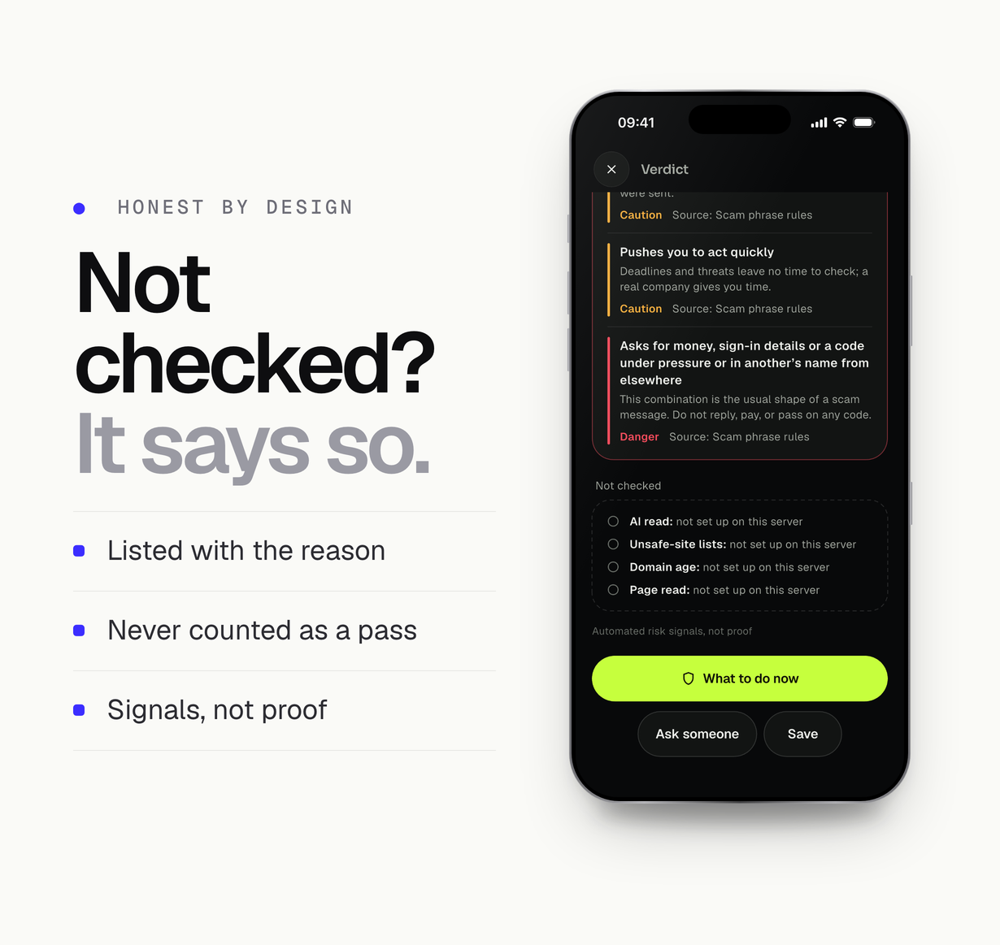
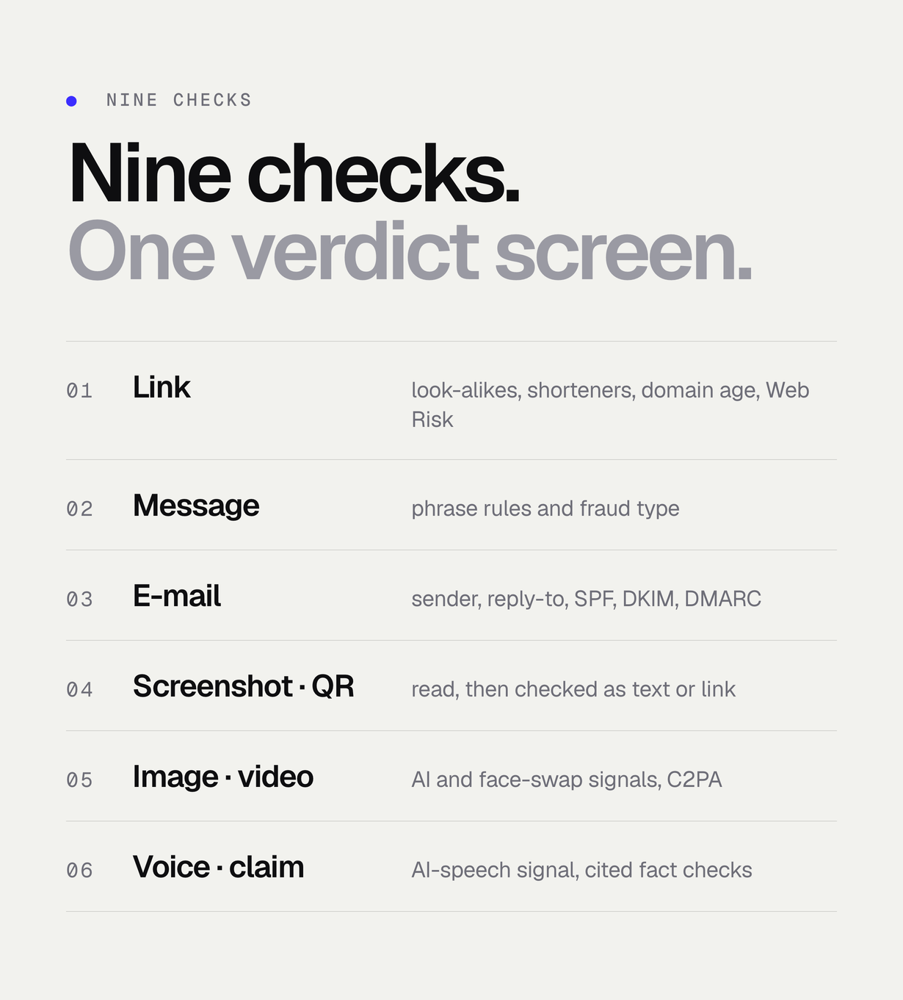

  

<h1 align="center">Truthbeam</h1>

  <b>AI scam and fake-content checker: Flutter app, Node server and console.</b>

AI scam detector & fact checker source code · phishing link check · fake image check · white-label app

  <a href="https://truthbeam-demo.mikodes.com/"><b>▶ Live demo</b></a> ·
  <a href="https://truthbeam.mikodes.com/docs/"><b>Docs</b></a> ·
  <a href="https://truthbeam.mikodes.com/"><b>Website</b></a> ·
  <a href="https://store.mikodes.com/p/truthbeam/"><b>Get the full source code</b></a>

  
  
  

  

> **This repository is a showcase.** It holds screenshots, documentation pointers and a real excerpt
> from the code. The full application is sold as source code at
> **[store.mikodes.com/p/truthbeam](https://store.mikodes.com/p/truthbeam/)**: one payment, instant ZIP download, free setup help.

---

## What it is

Launch a scam and fake-content check service under your own brand: users send a message, link, image or claim and get an evidence-based verdict on safety, authenticity and truth, with sources and a list of what was not checked.

## Screens

 

 

 

## Features

- **Evidence-based verdict on three axes**: Each answer lists findings with their source and time, plus a separate 'not checked' list with the reason.
- **Check jobs, daily quotas per plan and check type, global daily caps**: Free and Pro limits per install for light checks, media units, claim checks and assistant messages.
- **Link check: look-alike and punycode addresses, shortener expansion, domain age, Web Risk, AI read of the page**: Flags brand look-alikes, brand names on other sites, punycode, IP hosts and text before an @, opens shortened links first, reports domains registered in the….
- **Image check: AI-made and face-swap signals, Content Credentials, file metadata, seen elsewhere on the web**: Sightengine genai and deepfake scores against operator thresholds, C2PA manifests read on the server.
- **Video check**: Short shared video files only.
- **Voice message and audio check: AI-speech signal and transcript**: AI-speech score per recording.
- **Message check**: Pasted or shared SMS, chat and social-post text gets the local scam-phrase rules.
- **E-mail check**: Reads what the receiving mail server wrote into a shared .eml or pasted headers.
- **Screenshot check**: One screenshot of a post or chat gets every check that applies.
- **QR code check**: Nothing opens until the link check answered.
- **Claim and hoax check: published fact checks, then cited web research**: A claim gets published fact checks first.
- **Router and combined verdict with plain summary**: One item can get several checks.

## How it works

A technical case study of the architecture, one end-to-end flow, the key engineering decisions and how you would build something like this: **[docs/HOW-IT-WORKS.md](docs/HOW-IT-WORKS.md)**.

## A look at the code

Real excerpts from the source, shown for illustration:

- **Combining several checks into one verdict** ([`snippets/combine-verdicts.ts`](snippets/combine-verdicts.ts)): Several independent checks (link, image, message, claim) are merged into one verdict, with each axis decided by its own rule. Duplicate findings are listed once and an axis nobody checked is left out instead of being shown as safe.
- **Spotting look-alike domains** ([`snippets/lookalike-domains.ts`](snippets/lookalike-domains.ts)): Names are folded so Cyrillic letters, look-alike digits and sequences like "rn" read the same, then compared with a banded edit distance that gives up early, so a near-copy of a bank's address is caught cheaply.
- **Checksum-gated redaction** ([`snippets/redaction-checksums.ts`](snippets/redaction-checksums.ts)): Card numbers, IBANs, bank accounts and birth numbers are removed before text reaches any model, but only when the number passes its checksum, so ordinary numbers are left alone. The pass repeats until nothing changes.

## Requirements (full version)

- Node.js 26
- Linux server with glibc
- Flutter 3.41.4 or newer
- ffmpeg and ffprobe on the server PATH
- Build tools python3, make, g++ only when no prebuilt better-sqlite3 binary fits the server
- A domain or subdomain with https for the server

Not included: Hosting, VPS, domain and TLS certificate; Provider usage: Google Web Risk, Google Cloud Vision, Google Fact Check Tools, Sightengine, Anthropic or Perplexity, speech to text,…; Apple Developer Program and Google Play developer accounts; Reading SMS, calls or notifications in the background; Checking a video by its platform link.

## FAQ

**Is this the full source code?**  
No. This repository is a showcase with screenshots, a technical case study and real code excerpts. The complete Truthbeam source code is sold at [store.mikodes.com/p/truthbeam](https://store.mikodes.com/p/truthbeam/).

**What is Truthbeam built with?**  
Flutter, Node.js.

**Can I try it before buying?**  
Yes, open the [live demo](https://truthbeam-demo.mikodes.com/).

**Do I get help with the installation?**  
Free setup help is included with the store purchase; questions go to [mikodes.com/support](https://mikodes.com/support).

## Get the full source code

  

One payment, full licence, instant ZIP download and free setup help.
Questions: [mikodes.com/support](https://mikodes.com/support).

---

  Made by <a href="https://mikodes.com"><b>MIKODES</b></a> · <a href="https://github.com/Mikodesteam">more projects</a>

