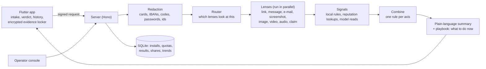

# How Truthbeam works

A case study of an app that checks whether a link, message, image, recording, e-mail or claim is a scam, a fake
or false, and tells the person what to do next. It is written from the real code; the excerpts linked below are
verbatim pieces of it. The complete application is not in this repository.

## The problem

People receive a delivery SMS, a "bank" e-mail, a voice message from a "relative", a too-good investment video.
They want an answer in seconds, in plain language, without sending their card number to an AI company. The hard
parts are not the individual checks (reputation lists, AI-image detectors, fact-check databases all exist) but
what surrounds them: combining several partial, sometimes failing, sometimes disagreeing signals into an honest
verdict; never leaking sensitive data to providers; and not claiming "safe" when nothing was actually verified.
Truthbeam is a Flutter app (English, Slovak, Czech) with a Node.js server that does this, plus an operator console
for whoever runs the service.

## Architecture

- **The app** collects the content (share sheet, paste, camera, file, QR), shows the verdict, keeps history, and
  keeps saved evidence in an encrypted on-device locker.
- **Server** (`server/src`): request authentication, redaction, routing, the lenses, the combiner, quotas, shared
  verdict pages, content (playbooks, lessons, alerts, trends) and purchase verification.
- **Lenses** are the check types. Each has a small interface and reports findings on one of three **axes**:
  *safety* (is it dangerous), *authenticity* (is it AI-made or manipulated), *truth* (is the claim supported).
- **Signals** are the units a lens is built from: a local rule, a provider lookup, or a model read. A signal can
  fail or be unconfigured without taking the others down.

## One flow end to end: pasting a suspicious SMS

1. **Consent and signature.** The app has a P-256 key pair created on the device; the server keeps only the public
   half. Every request carries an ECDSA signature over a canonical string (timestamp, nonce, method, path and the
   SHA-256 of the body). A check also needs recorded consent (the server answers 412 without it).
2. **Redaction.** The text is redacted before any lens or model sees it ([excerpt](../snippets/redaction-checksums.ts)).
   Links are extracted from the original text first, because redaction may remove a link from the text but must
   never remove it from the checks.
3. **Routing.** The router picks lenses from the intake: a text always gets the *message* lens, also the *link* lens
   when it contains a link, and the *claim* lens when it is long enough to hold a claim. A link goes to the link
   lens; an image to the screenshot or image lens; audio, video and e-mail to theirs. A second step adds
   follow-ups from what the first found: a screenshot's text goes through the message and claim checks, a
   recording's transcript is redacted and routed like a pasted text.
4. **Quota.** A check costs one "light" unit, or media units for files; units are taken up front and given back for
   work that did not happen. Daily limits depend on the plan and there are global daily caps.
5. **Signals run in parallel**, each under its own timeout (12 s) and the check's overall budget (45 s, longer for
   video). The message lens classifies the scam type (delivery, bank, investment, romance, job and so on) and
   extracts links, phone numbers and accounts. The link lens expands shorteners, checks look-alike domains
   ([excerpt](../snippets/lookalike-domains.ts)), the domain's age, a web-risk list and reads the page, which is
   fetched through a guarded fetcher.
6. **Combine.** Findings from all lenses are merged into one verdict by the combiner
   ([excerpt](../snippets/combine-verdicts.ts)).
7. **Summary and playbook.** A short plain-language summary is written; the app shows the matching playbook for the
   scam type and language (what to do now, which official contacts to use).
8. **Result.** The app shows three axes where each has a state and a list of findings with their source and time,
   and a list of checks that did not run. The person may save the check to the locker or share a read-only
   "second opinion" page.

## Key engineering decisions

### 1. Three axes instead of one score

*Chosen:* every result has up to three verdicts (safety, authenticity, truth), each decided by its own rule.
*Alternative:* a single risk percentage. *Why:* "this link is dangerous" and "this photo is AI-made" are
different statements with different evidence, and a single number hides which one is being claimed. Axes also make
it natural to leave one out: a text with no checkable claim has no truth axis at all.

### 2. "Not checked" is a first-class result, and never counts as a pass

*Chosen:* a signal that is not configured, timed out, hit a provider error or ran out of daily allowance is
recorded as *not run* with a reason, and shown to the person. Safety is **OK only when a reputation or model signal
answered for safety, every finding is OK and no check was left out**; local rules alone never make it OK.
*Alternative:* ignore failed signals and show what remains. *Why:* a scam verdict that quietly drops a failed
phishing-list lookup is worse than none. The cost is more "Caution" results, which is the honest outcome.

### 3. Redact first, on the server and on the device, with shared test vectors

*Chosen:* one set of redaction rules (card numbers, IBANs, Czech and Slovak accounts, one-time codes, passwords,
national ids) runs before text reaches any provider or model, and the same rules exist on the phone. Both are
tested against one shared file of cases, which is why the rules are written to be portable (ASCII digits, UTF-16
offsets, regular expressions that Dart also runs). Numbers are removed only when they pass their checksum.
*Alternative:* ask the model to ignore sensitive data, or redact only on the server. *Why:* prevention beats
instruction, and checksum gating keeps a phone number or a parcel number readable for the checks that need it.

### 4. A parallel signal runner with isolation per signal

*Chosen:* every signal runs under its own timeout and abort scope, failures are converted to a reason, and one
failure never stops the others. *Alternative:* a sequential pipeline. *Why:* a check must answer within seconds even
if one provider is slow, and the person should see what was checked and what was not.

### 5. Findings never quote the checked content

*Chosen:* by contract, a finding's title and detail say what a signal found ("The domain was registered 3 days
ago"), never quote or paraphrase the content, and a finding's URL is its source, never the checked link.
*Alternative:* show the matched text and link. *Why:* verdicts can be shared with another person on a read-only page;
a finding that echoed the message would leak it, and a clickable link to the scam site would be a hazard.

## Security and safety measures that exist in the code

- **Signed requests.** Device key pair, public key stored by the server, signature over method, path, body hash,
  timestamp and nonce, with a five-minute clock window. A pinned test vector is shared by both sides.
- **Redaction** before models and providers, as above, with idempotence (running it again changes nothing).
- **SSRF-safe page fetching.** The server reads a page for a link check only over http or https, on ports 80, 443,
  8080 and 8443, refuses any private or reserved address in any DNS answer, connects to the address it checked
  (no second lookup), follows a limited number of redirects re-checking each hop, sends no cookies or credentials,
  reads only text or HTML up to a byte limit and within a total time limit.
- **Upload guard.** Uploads are classified by content (not by file name), limited by size and by duration for audio
  and video, stored in a temporary place and disposed of when the check ends. A result is kept for a configurable
  number of hours (24 by default).
- **Rate limits and quotas.** Token-bucket limiters per client, plus daily per-plan quotas and global caps.
- **Shared verdict pages** use unguessable 128-bit slugs, expire (30 days by default, never more than a year),
  can be revoked, and show only findings marked shareable.
- **Evidence locker.** On the phone, AES-256-GCM in 1 MiB chunks, each with its own random nonce and bound to its
  place, blob, position and an end-of-file flag, so chunks cannot be reordered, moved or cut. The key sits in the
  platform's secure storage.
- **Trends are opt-in and coarse.** Scam trends use closed days, a minimum number of installs per type, and rounded
  counts.
- **Purchase verification** for the Pro subscription happens on the server against the stores.

## How you would build something like this

1. **Define the result contract first.** Axes, states, findings (with source and time) and the list of "not run"
   reasons. A JSON schema that the app and the server share keeps both sides honest.
2. **Build one lens end to end** (the link lens is a good one) with a clean `Signal` interface: configured?, run,
   result or "no data", throw on failure. Wrap it in a runner with timeouts before adding a second lens.
3. **Write the combiner as pure functions** with one rule per axis and a table of tests. This is where the product's
   honesty lives.
4. **Add redaction early**, with checksum gating and a shared vector file, and apply it at the entrance so no later
   code can forget.
5. **Add the router** so new lenses plug in without changes elsewhere, and so follow-up checks (a screenshot's text
   becomes a message check) are explicit.
6. **Treat any URL the server will fetch as hostile**: validate scheme and port, resolve DNS yourself, check every
   address, pin the connection to what you checked, cap size and time.
7. **Only then add the AI**: the model reads and summarises; rules and providers decide. Keep prompts away from
   anything the redaction removed.
8. **Finish with the human side**: plain-language summaries, a "what to do now" playbook per scam type and
   language, shareable second opinions, and a locker for evidence.

## Deployment and customization

The server is a Node.js application with a Docker image (Debian) and a health check, and the data is a SQLite
database. The operator console (built on the MIKODES Admin Kit) holds provider keys with connection tests, a costs
page, status checks, plans, store settings, branding, team and an audit log, and a read-only demo mode. The app is
Flutter for iOS and Android with English, Slovak and Czech texts; you can change the brand, the scam patterns and
brand list per language, the playbooks and lessons, the plans and the quotas.

Full source code, docs and setup help: https://store.mikodes.com/p/truthbeam/
